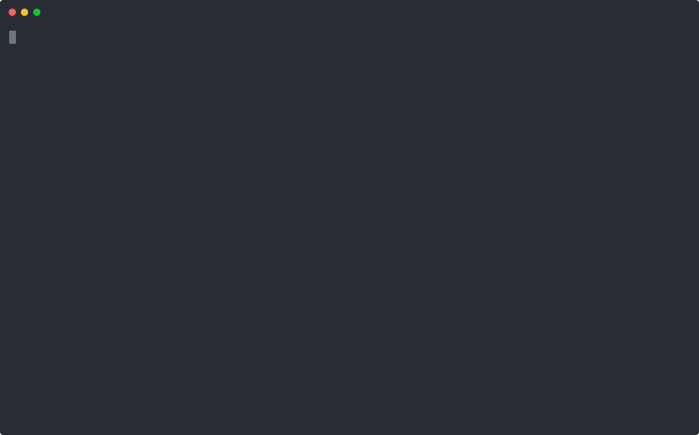
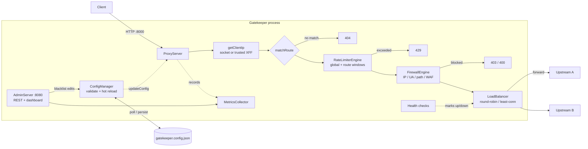

# Gatekeeper Proxy

[](https://github.com/tatitoxt/gatekeeper-proxy/actions/workflows/ci.yml)
[](LICENSE)

A small HTTP reverse proxy written in TypeScript on Node's built-in `http` module. It sits in front of
one or more backend services and adds routing, load balancing, per-IP rate limiting, a basic
signature-based firewall and an admin dashboard — configured with one JSON file that is hot-reloaded.

It is a learning/portfolio project: the code is meant to be read. See [Limitations](#limitations)
before thinking about putting it in front of anything real.

<p align="center">
  
</p>

## Problem

Small services often need the same edge concerns — "send `/api` to these two instances", "stop one
client from hammering `/auth`", "drop obvious scanner traffic", "block this IP now" — before they
justify a full API gateway. Gatekeeper implements those concerns in under 2k lines of dependency-light
TypeScript so the mechanics (sliding-window limits, health-checked balancing, proxy header handling,
trust boundaries) are visible and tested.

## What it does today

| Area | Behaviour |
| --- | --- |
| Routing | Longest path-prefix match on whole segments (`/api` matches `/api/x`, not `/apiary`); unmatched paths get `404`. |
| Load balancing | `round-robin` or `least-connections` per route. |
| Clustering | `cluster.workers: N` forks N proxy workers sharing the listener via `node:cluster` (respawned on exit); the primary owns the admin API alone. Pair with the Redis backend for a shared rate-limit budget across workers. |
| Health checks | Routes with `healthCheckPath` are probed every `healthCheck.intervalMs` (http and https targets); failing targets (or ones that refuse connections) leave rotation until a probe succeeds, and `503` is returned when none are left. |
| Circuit breaker | Passive, needs no probes: `circuitBreaker.failureThreshold` consecutive upstream failures (connect errors *or* 5xx responses) take a target out for `circuitBreaker.openMs`, then a half-open trial either closes the breaker or reopens it. A healthy response clears the streak. |
| Proxying | Streams bodies both ways over pooled keep-alive upstream connections (`upstream.keepAlive`/`maxSockets`/`maxFreeSockets`), sets `X-Forwarded-For/-Host/-Proto` and `X-Real-IP`, strips hop-by-hop headers, `502` on upstream errors and `504` after `server.timeoutMs`. Targets may be `http://` or `https://`, and `route.upstreamHttp2` speaks HTTP/2 to the upstream, multiplexed over one pooled session per origin (cannot combine with `healthCheckPath`). |
| Rate limiting | Sliding window per client IP: a global limit plus optional per-route limits. Returns `429` with `X-RateLimit-*` and `Retry-After`. Two backends: in-memory (default) or Redis (`rateLimiter.backend: "redis"`), which shares the budget across instances via one atomic Lua script per check. |
| Firewall | IP allowlist/blocklist (IPv4/IPv6, CIDR), blocked User-Agent substrings, custom path regexes, and pattern rules for SQL injection, XSS and path traversal on the (up to 3× percent-decoded) URL. Malformed encoding gets `400`. |
| Client IP | Uses the socket address. `X-Forwarded-For` is only honoured when `server.trustProxy` is `true` (right-most hop), so clients cannot spoof their way around IP rules. |
| Config | JSON file validated on start (all errors reported at once) and polled for changes; an invalid edit is rejected and the last valid config stays active. |
| Admin | REST API + dashboard on a separate port: metrics, recent security events, routes, add/remove IP blocklist entries (persisted to the config file). Bearer-token auth via `GATEKEEPER_ADMIN_TOKEN`; without a token it refuses to bind a non-loopback address. |

## Quickstart

Requires Node.js 20 or 22.

```bash
git clone https://github.com/tatitoxt/gatekeeper-proxy.git
cd gatekeeper-proxy
npm ci
npm run build

# Terminal 1: three synthetic backends on 127.0.0.1:9001-9003 that echo what they receive
npm run demo:upstreams

# Terminal 2: the gateway, using ./gatekeeper.config.json (proxy :8000, admin :8080)
GATEKEEPER_ADMIN_TOKEN=change-me npm start
```

Then, in a third terminal:

```bash
# Routing + round-robin: run twice, "upstream" alternates between 9001 and 9002
curl -s localhost:8000/api/v1/orders/42

# Firewall: SQL injection, scanner user agent, sensitive path -> 403
curl -s -i "localhost:8000/api/v1/users?id=1%27%20OR%20%271%27=%271" | head -1
curl -s -i -A "sqlmap/1.8" localhost:8000/api/v1/ping | head -1
curl -s -i localhost:8000/.env | head -1

# Rate limit: /auth allows 10 requests/minute per IP -> the 11th is 429
for i in $(seq 1 11); do curl -s -o /dev/null -w "%{http_code} " -X POST localhost:8000/auth/login; done; echo

# Admin API (401 without the token)
curl -s -H "Authorization: Bearer change-me" localhost:8080/api/metrics
curl -s -X POST -H "Authorization: Bearer change-me" -H "Content-Type: application/json" \
  -d '{"ip":"203.0.113.7"}' localhost:8080/api/firewall/blacklist

# Prometheus scrape endpoint (no token needed; admin listener is loopback-only by default)
curl -s localhost:8080/metrics
```

Open <http://localhost:8080/_admin> and paste the token to see the dashboard.

### Docker

```bash
GATEKEEPER_ADMIN_TOKEN=change-me docker compose up --build
```

This starts the synthetic upstreams and the gateway with [`examples/docker.config.json`](examples/docker.config.json).
The proxy is published on `:8000`; the admin port on `127.0.0.1:8080` only. The same `curl` commands work.
The bind-mounted config must be writable by UID 1000 (the image's `node` user) for blocklist edits to persist;
if it is not, the admin API returns `500` and does not apply the change.

## Configuration

[`gatekeeper.config.json`](gatekeeper.config.json) is the example used by the demo and E2E tests.

| Key | Default | Notes |
| --- | --- | --- |
| `server.port` / `server.host` | `8000` / `0.0.0.0` | Proxy listener. |
| `server.adminPort` / `server.adminHost` | `8080` / `127.0.0.1` | Admin listener. Non-loopback requires a token. |
| `server.timeoutMs` | `30000` | Upstream timeout → `504`. |
| `server.trustProxy` | `false` | Honour `X-Forwarded-For` (only behind your own proxy/LB). |
| `server.http2` | `false` | Accept HTTP/2 on the proxy listener. With `server.tls` it negotiates h2 vs HTTP/1.1 via ALPN (both work); without TLS the listener is h2c **prior-knowledge only** — plain HTTP/1.1 requests fail. Upstreams stay HTTP/1.1 either way. |
| `routes[]` | `[]` | `pathPrefix`, `targets` (http URLs), `balanceStrategy`, `healthCheckPath`, `rateLimit {windowMs, maxRequests}`, `waf` (per-route overrides for `firewall.wafRules`; unset keys inherit the globals). |
| `firewall` | enabled, all WAF rules on | `ipBlacklist`, `ipWhitelist`, `blockedUserAgents`, `customBlockedPaths` (regex), `wafRules`, `inspectedHeaders` (header names scanned with the WAF signatures, e.g. `["referer"]`), `inspectBody` (`enabled`, `maxBytes` default 65536, `contentTypes` — POST/PUT/PATCH/DELETE bodies of a matching content type are buffered up to `maxBytes` and scanned with the same signatures; larger and non-matching bodies stream through uninspected). |
| `rateLimiter` | `60000` ms / `300` | Global per-IP window. `backend`: `memory` (default) or `redis`; when `redis`, `redisUrl` is required and `keyPrefix` namespaces the counters (default `gk:rl:`). |
| `healthCheck` | `10000` / `3000` ms | Probe interval and timeout. |
| `circuitBreaker` | `5` / `30000` ms | `failureThreshold` consecutive failures open the breaker for `openMs`. |

| Environment variable | Purpose |
| --- | --- |
| `GATEKEEPER_CONFIG` | Config file path (default `./gatekeeper.config.json`). |
| `GATEKEEPER_ADMIN_TOKEN` | Bearer token for the admin API and dashboard. |
| `LOG_LEVEL` / `LOG_FORMAT=json` | Pino log level / force JSON logs (JSON is the default when `NODE_ENV=production`). |

## Architecture



| Path | Responsibility |
| --- | --- |
| [`src/index.ts`](src/index.ts) | CLI entrypoint: wires config, proxy, admin; graceful shutdown on SIGINT/SIGTERM. |
| [`src/core/proxy.ts`](src/core/proxy.ts) | Request pipeline, forwarding, header handling, error mapping. |
| [`src/core/load-balancer.ts`](src/core/load-balancer.ts) | Target selection, connection counts, active/passive health, circuit breaker. |
| [`src/rate-limiter/rate-limiter.ts`](src/rate-limiter/rate-limiter.ts) | Sliding-window counters with an injectable clock. |
| [`src/firewall/firewall.ts`](src/firewall/firewall.ts) | IP/UA/path rules and WAF signatures. |
| [`src/config/config.ts`](src/config/config.ts) | Schema validation, defaults, hot reload, persistence. |
| [`src/admin/`](src/admin) | Admin REST API and the dashboard (strict CSP, no inline script, untrusted data rendered as text). |

## Tests

```bash
npm run lint           # ESLint (typescript-eslint)
npm run typecheck      # tsc over src, tests and e2e
npm test               # unit + integration (Jest)
npm run test:coverage  # same, with a coverage report
npm run test:e2e       # builds, then black-box tests against `node dist/index.js`
npx playwright install chromium   # once
npm run test:e2e:browser          # Playwright test of the admin dashboard
npm run check          # everything above
```

- **Unit** (`tests/unit`): config validation, IP parsing, firewall rules, rate-limit windows, load balancer, route matching, metrics.
- **Redis integration** (`tests/integration/rate-limiter-redis.test.ts`): runs only when
  `GATEKEEPER_TEST_REDIS_URL` is set; covers the shared budget across two engine
  instances, route+global windows in one atomic check, and key accounting.
- **Integration** (`tests/integration`): an in-process `ProxyServer` / `AdminServer` on real sockets against local upstream servers — forwarding, headers, WAF, 429s, 502/504, failover, admin auth and validation.
- **E2E** (`e2e/`): starts the compiled CLI and the synthetic upstreams as child processes with a temp config and random ports, then uses plain HTTP: routing, firewall, rate limiting, admin blocklist on live traffic, config hot reload (valid and invalid edits), health-check failover, startup failure on bad config, graceful SIGTERM. A Playwright test drives the dashboard in Chromium, including a check that an XSS payload from a blocked request is rendered as text. An 8 MiB body upload proves the proxy streams payloads without buffering them in memory.

Measured in this repository (Node 22, Linux): 153 Jest unit/integration tests, 17 process-level E2E tests and 1 Playwright
test pass; `npm run test:coverage` reports ~94% statement coverage of `src/` (excluding `src/index.ts`, which the E2E suite covers).
CI runs the unit/integration job on Node 20 and 22, the E2E job, `npm audit --audit-level=high`, and a Docker Compose smoke test.

## Limitations

- **Not production-hardened.** Throughput was benchmarked once (see [docs/benchmarks.md](docs/benchmarks.md): ~3.3k req/s proxied, ~33k req/s WAF-rejected, on a single process) but it has not been security-audited or soaked.
- **The WAF is pattern-based** and inspects the URL (path + query), the headers named in `inspectedHeaders`, and — when
  `firewall.inspectBody.enabled` is set — request bodies of the configured content types up to `inspectBody.maxBytes`
  (default 64 KiB; larger bodies pass uninspected). It is easy to bypass and can produce false positives; treat it as a
  demonstration of the technique, not protection.
- **State is per process and in memory** unless `rateLimiter.backend` is `redis`: metrics and events still reset on restart and are not shared
  between instances.
- **HTTP/2**: `server.http2` accepts HTTP/2 on the listener (ALPN under TLS, prior-knowledge h2c cleartext) and `route.upstreamHttp2` contacts upstreams over HTTP/2; the two compose (h2 client → h1 upstream, h1 client → h2 upstream, and full h2). Upstream h2 sessions cannot be health-probed (probes speak HTTP/1.1), so validation refuses `upstreamHttp2` + `healthCheckPath` on the same route. WebSocket/`Upgrade` remains HTTP/1.1-only. TLS termination is supported (`server.tls` with `certFile`/`keyFile`, optional `caFile` + `requestCert` for mTLS) and upstreams may be `https://`.
- **Hot reload applies routes, firewall and limits**; changing listener ports/hosts requires a restart.
- The admin API uses a single static bearer token; there are no users, roles or audit log.
- `npm audit` reports moderate findings in dev-only tooling (`minimatch` via `eslint`/`typescript-eslint`); the fixed `minimatch`
  line is very new, so it is not forced. Production dependencies (`npm audit --omit=dev`) report none, and CI fails on high/critical.

## License

[MIT](LICENSE) © Fausto Pastura
